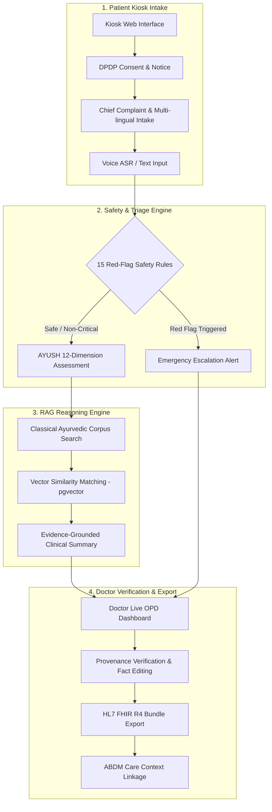
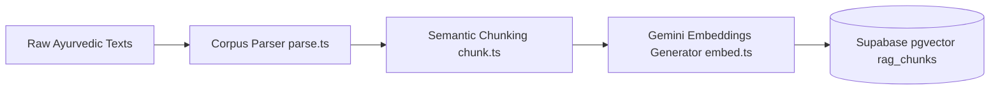
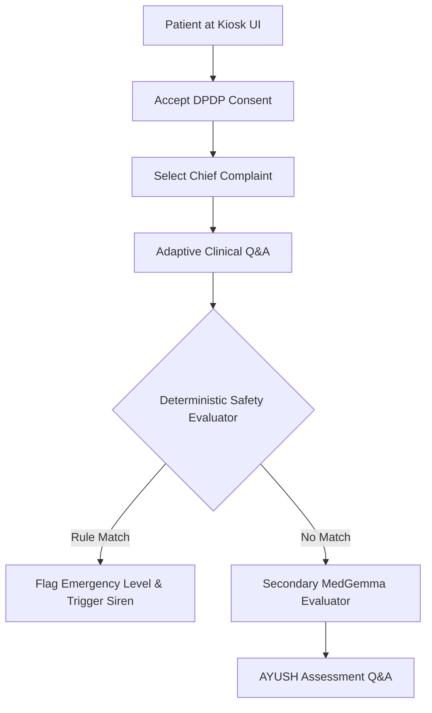
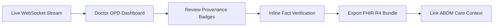

# System Workflow & Execution Architecture

- **Last Analyzed**: 2026-09-16
- **Git Commit Hash**: `f118085510bdf2fa44785ee3ca5aaf5b4875c209`

---

## 1. End-to-End Clinical System Workflow

The MediKiosk clinical platform orchestrates multi-lingual patient intake, automated triage, AYUSH clinical decision support, and doctor verification.



---

## 2. System Sub-Workflows & Stage Details

### Phase 1: Data Ingestion & RAG Corpus Pre-seeding



- **Entry Points**: [`backend/src/rag/parse.ts`](file:///c:/game/pythoncoding/New%20folder/hackathon/backend/src/rag/parse.ts), [`backend/src/rag/chunk.ts`](file:///c:/game/pythoncoding/New%20folder/hackathon/backend/src/rag/chunk.ts), [`backend/src/rag/embed.ts`](file:///c:/game/pythoncoding/New%20folder/hackathon/backend/src/rag/embed.ts), [`backend/src/rag/preseed.ts`](file:///c:/game/pythoncoding/New%20folder/hackathon/backend/src/rag/preseed.ts)
- **Inputs**: Ancient text corpus in [`rag_corpus/raw/`](file:///c:/game/pythoncoding/New%20folder/hackathon/rag_corpus/raw/)
- **Outputs**: Embedded 768-dimensional vectors seeded in `rag_chunks` table

**Execution Command Sequence**:
```bash
# 1. Parse raw text into structured JSON format
npx tsx backend/src/rag/parse.ts

# 2. Chunk text into semantic sections with metadata
npx tsx backend/src/rag/chunk.ts

# 3. Generate vector embeddings using Gemini API
npx tsx backend/src/rag/embed.ts

# 4. Seed vector embeddings into Supabase pgvector store
npx tsx backend/src/rag/preseed.ts
```

---

### Phase 2: Kiosk Intake & Emergency Screening Workflow



1. **Consent & Registration**: Patient completes DPDP Act 2023 compliant consent screen (`/consent`).
2. **Audio/Text Intake**: Speech input processed via Sarvam Saaras v3 ASR (`/api/sarvam/asr`) or touch interface.
3. **Emergency Red-Flag Screening**: Evaluated against 15 deterministic red-flag rules in [`backend/src/redflags.ts`](file:///c:/game/pythoncoding/New%20folder/hackathon/backend/src/redflags.ts).
4. **Document & Record Extraction**: Uploaded medical reports are scanned via Gemini Document OCR (`/api/gemini/extract-entities`).

---

### Phase 3: Doctor Triage & EHR Integration Workflow



1. **OPD Dashboard**: Real-time triage queue displaying patient risk scores and emergency alerts.
2. **Provenance Badging**: Clear demarcation between `patient_reported`, `ocr_extracted`, and `doctor_entered` data points.
3. **Interoperability Standard**: Standardized output as an HL7 FHIR R4 Bundle (`/api/fhir/:sessionId`) and integrated with Ayushman Bharat Digital Mission (ABDM).

---

## 3. Local & Containerized Setup Workflow

### Prerequisites
- **Node.js**: v22 LTS (specified in `package.json`, `.node-version`)
- **npm**: ^10.0.0
- **Docker & Docker Compose** (optional container runtime)

### Quickstart Commands
```bash
# 1. Install dependencies across packages
npm install
cd backend && npm install
cd ../frontend && npm install

# 2. Configure Environment Variables
cp backend/.env.example backend/.env
cp frontend/.env.example frontend/.env

# 3. Run Concurrent Local Server (Backend: 3001, Frontend: 5173)
npm run demo
```

---

## 4. Cloud Deployment Architecture

- **Backend Service**: Deployed to Railway using Nixpacks configuration ([`railway.json`](file:///c:/game/pythoncoding/New%20folder/hackathon/railway.json)).
- **Frontend App**: Deployed to Vercel with SPA routing rules ([`vercel.json`](file:///c:/game/pythoncoding/New%20folder/hackathon/vercel.json)).
- **Database**: Supabase Cloud PostgreSQL with pgvector extension enabled.
