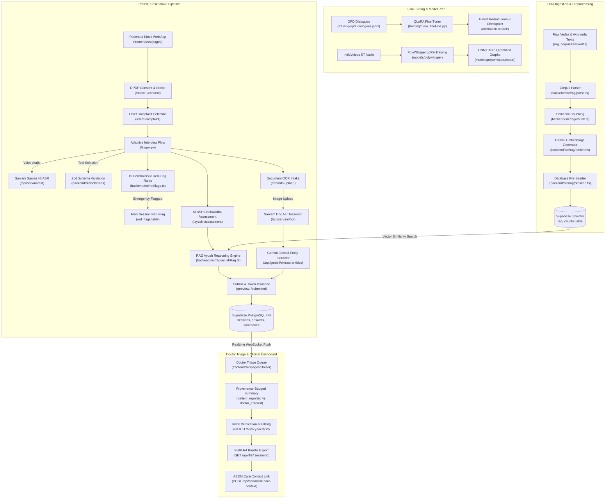

# System Workflow & Execution Architecture

- **Last Analyzed**: 2026-09-16
- **Git Commit Hash**: `f118085510bdf2fa44785ee3ca5aaf5b4875c209`

---

## 1. End-to-End System Architecture & Data Flow



---

## 2. Setup and Installation Workflow

### Prerequisites
- **Node.js**: v22 LTS (specified in `.node-version`, `package.json`, `Dockerfile`)
- **npm**: ^10.0.0
- **Docker & Docker Compose** (optional for containerized runtime)
- **Ollama Runtime** (optional for local MedGemma LLM execution)

### Execution Commands
```bash
# 1. Install root, backend, and frontend dependencies
npm install
cd backend && npm install
cd ../frontend && npm install

# 2. Configure Environment Variables
cp backend/.env.example backend/.env
cp frontend/.env.example frontend/.env

# 3. Initialize Supabase Schema
# Execute backend/schema.sql in Supabase SQL Editor
```

---

## 3. Data Ingestion & Preprocessing Workflow

- **Entry Point**: [`backend/src/rag/build_full_corpus.ts`](file:///c:/game/pythoncoding/New%20folder/hackathon/backend/src/rag/build_full_corpus.ts) & [`backend/src/rag/preseed.ts`](file:///c:/game/pythoncoding/New%20folder/hackathon/backend/src/rag/preseed.ts).
- **Config Files**: [`backend/.env`](file:///c:/game/pythoncoding/New%20folder/hackathon/backend/.env) (`SUPABASE_URL`, `SUPABASE_SERVICE_ROLE_KEY`, `GEMINI_API_KEY`).
- **Inputs**: Raw Vedic and Ayurvedic text datasets in [`rag_corpus/raw/`](file:///c:/game/pythoncoding/New%20folder/hackathon/rag_corpus/raw/).
- **Outputs**: Embedded chunks stored in Supabase table `rag_chunks`.

### Order of Execution
```bash
# Parse raw files into standardized JSON structures
npx tsx backend/src/rag/parse.ts

# Segment documents into semantic chunks with metadata tags
npx tsx backend/src/rag/chunk.ts

# Generate 768-dim text embeddings via Gemini API
npx tsx backend/src/rag/embed.ts

# Seed embeddings and metadata into Supabase vector store
npx tsx backend/src/rag/preseed.ts
```

---

## 4. Model Training & Fine-Tuning Workflow

### 4.1 OPD Clinical Dialogue QLoRA Fine-Tuning
- **Entry Point**: [`training/qlora_finetune.py`](file:///c:/game/pythoncoding/New%20folder/hackathon/training/qlora_finetune.py).
- **Base Model**: `meta-llama/Meta-Llama-3-8B-Instruct`.
- **Dataset Input**: [`training/opd_dialogues.jsonl`](file:///c:/game/pythoncoding/New%20folder/hackathon/training/opd_dialogues.jsonl).
- **Hyperparameters**:
  - Quantization: 4-bit NormalFloat (`nf4`) double quantization, `bfloat16` compute.
  - LoRA Config: rank `r=16`, `lora_alpha=32`, `target_modules=["q_proj", "k_proj", "v_proj", "o_proj", "gate_proj", "up_proj", "down_proj"]`.
  - Batch size: 4 per device, gradient accumulation steps: 4.
  - Learning rate: `2e-4` with cosine scheduler.
- **Output Artifact**: `./medikiosk-model/` PEFT adapter weights.
- **Execution Command**:
  ```bash
  python training/qlora_finetune.py
  ```

### 4.2 PolyWhisper Multilingual Indic ASR Training & ONNX Export
- **Entry Point**: [`models/polywhisper/app.py`](file:///c:/game/pythoncoding/New%20folder/hackathon/models/polywhisper/app.py).
- **Base Model**: `openai/whisper-small` (244M params).
- **Adapters**: Rank-16 LoRA per language (Hindi, Tamil, Telugu, Bengali, Marathi) (~14MB each).
- **ONNX Export Command**:
  ```bash
  polywhisper export --lang hi --variant prod --int8
  ```

---

## 5. Runtime Inference & Prediction Pipeline

### 5.1 Patient Intake & Real-Time Emergency Screening
1. **Patient Authentication & Consent**: Patient opens Kiosk UI (`/welcome`), reviews DPDP Notice (`/notice`), and grants consent (`/consent`).
2. **Chief Complaint & Adaptive Interview**: Patient records symptoms via speech (`/api/sarvam/asr`) or touch UI.
3. **Deterministic Safety Evaluation**: Each submitted answer is evaluated by 15 deterministic red-flag rules (`backend/src/redflags.ts:L4-L20`). If matched, session `red_flag` flips to `true` and records entry in `red_flags` table.
4. **Secondary Semantic Safety**: Answers without deterministic matches undergo secondary evaluation via MedGemma LLM / Gemini (`backend/src/redflags.ts:L69-L99`).
5. **AYUSH RAG Assessment**: AYUSH 12-dimension responses are evaluated by `reasonAyushWithRag()` (`backend/src/rag/ayushRag.ts:L55-L277`). Vector similarity query retrieves top-5 classical text chunks from Supabase `rag_chunks` to generate cited clinical insights.
6. **Prescription OCR Extraction**: Uploaded prescription images are processed via Sarvam Doc AI digitise or local Tesseract.js (`backend/src/app.ts:L976-L1010`), followed by Gemini clinical entity extraction (`backend/src/app.ts:L1012-L1068`).

### 5.2 Doctor Triage & Clinical Verification
1. **Live OPD Queue**: Clinician logs in (`/auth/login`) and views active OPD sessions sorted by triage priority and red-flag status. Real-time updates pushed via Supabase WebSocket publication `supabase_realtime`.
2. **Inline Verification**: Doctor reviews provenance tags (`patient_reported`, `ocr_extracted`, `system_derived`). Edits or verifies facts, which updates provenance to `doctor_entered` (`PATCH /history-facts/:id`).
3. **FHIR R4 Bundle Export**: Clinician exports complete clinical visit record as an HL7 FHIR R4 Bundle (`GET /api/fhir/:sessionId`).
4. **ABDM Linkage**: Care Context linked with ABHA address (`POST /api/abdm/link-care-context`).

---

## 6. Deployment & Monitoring Workflow

### Local Development / Demo Mode
```bash
# Concurrent local execution (Backend on 3001, Frontend on 5173)
npm run demo

# Clean shutdown of local processes
npm run demo:stop
```

### Docker Containerized Deployment
```bash
# Launch multi-container stack (Backend on 3001, Frontend on 8080)
docker compose up -d
```

### Cloud Production Targets
- **Backend**: Deployed to Railway via Nixpacks Node.js 22 runtime (`railway.json`).
- **Frontend**: Deployed to Vercel with SPA rewrite rules (`vercel.json`).

### Monitoring & Event Auditing
- Real-time orchestration event stream exposed via SSE at `GET /api/orchestration/events` (`backend/src/app.ts:L109-L124`).
- All doctor verifications, data access, and consent revocations written to `audit_logs` table (`backend/src/app.ts:L265`, `backend/src/app.ts:L764`).
